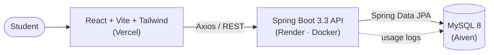
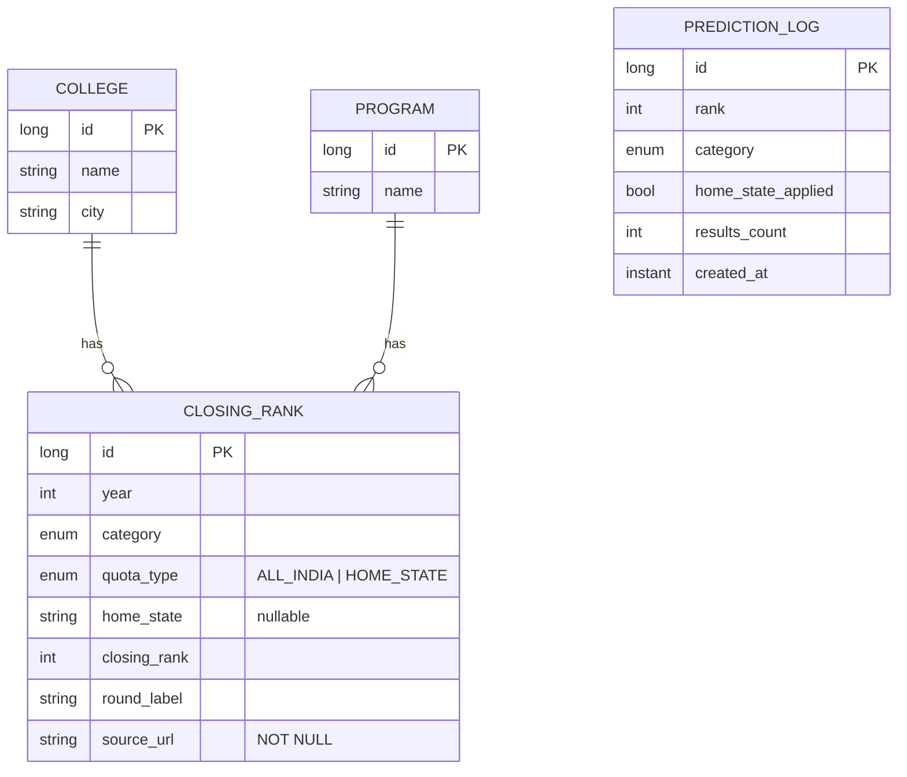

<div align="center">

# ⚖️ CLAT College Predictor

**Know where your CLAT rank can realistically take you — backed by cited, multi-year closing-rank data, not guesswork.**

[](https://clat-college-predictor.vercel.app)
[](https://clatpredictor-backend.onrender.com/api/closing-ranks?category=GENERAL&program=BA%20LLB%20(Hons.))


<br/>


</div>

---

## ✨ Why this exists

Most CLAT predictors use **one year** of data and apply the **same margin to every college**. That's misleading: NLSIU's closing rank barely moves, while others swing wildly.

This project fixes three things:

| Problem with typical predictors | What this project does |
|---|---|
| One year of data, assumed to repeat | Multi-year history; **margin computed from each college's own volatility** |
| All programs collapsed into one number | **BA LLB / BSc LLB / BBA LLB / BCom LLB** kept separate |
| Home-state seats ignored or silently guessed | Separate quota model; home-state output is a **clearly labelled, adjustable estimate** |
| Unsourced numbers shown as fact | **Every closing rank stores a mandatory `source_url`**; unverified data is left out, not guessed |

## 🚀 Features

- 🎯 **Safe / Moderate / Ambitious** tiers from rank, category (General · EWS · OBC · SC · ST) and program
- 📈 **Trend-adjusted prediction bands** per college (falls back to category defaults when history is thin)
- 🧪 **Backtesting panel** — trains on earlier years, checks whether the band would have bracketed the real next year
- 🏠 **Home-state quota estimator** with an adjustable multiplier (1.2×–4×)
- 🔎 **"Where does this data come from?"** panel listing every source
- 📊 **Usage logging** (`/api/predictions-log`, `/api/stats`) for analytics
- 🐳 **Dockerised backend**, deployed across Vercel + Render + Aiven

<!-- Replace with real screenshots -->
<p align="center">
  
  
</p>

## 🧠 How the prediction works

For each college, the closing rank `c` (latest verified year) is compared with your rank `r`:

```text
r ≤ c × safe          →  🟢 Safe
r ≤ c                 →  🟡 Moderate
r ≤ c × ambitious     →  🔴 Ambitious
otherwise             →  not shown
```

When a college has **≥ 2 verified General-category years**, the margins come from its own year-on-year swing:

```js
avgSwing  = mean( |rank[i] - rank[i-1]| / rank[i-1] )
safe      = max(0.55, 1 - avgSwing*1.2 - (1 - base.safe)*0.3)
ambitious = min(1.9,  1 + avgSwing*1.5 + (base.ambitious - 1)*0.3)
```

Otherwise it falls back to category defaults:

| Category | Safe | Ambitious |
|---|---|---|
| General | 0.85× | 1.15× |
| EWS | 0.70× | 1.30× |
| OBC | 0.65× | 1.40× |
| SC | 0.55× | 1.55× |
| ST | 0.55× | 1.60× |

> ⚠️ Predictions are estimates from historical data — **not** official counselling outcomes.

## 🏗️ Architecture



### Data model



## 🔌 API

Base path: `/api`

| Method | Endpoint | Description |
|---|---|---|
| `GET` | `/closing-ranks?category=GENERAL&program=BA LLB (Hons.)&quota=ALL_INDIA` | Closing ranks for a category/program/quota |
| `GET` | `/colleges/{name}/history?category=GENERAL&program=BA LLB (Hons.)` | Year-by-year history (powers trend + backtest) |
| `POST` | `/predictions-log` | Log a prediction request |
| `GET` | `/stats` | Aggregate usage stats |

```bash
curl "https://clatpredictor-backend.onrender.com/api/closing-ranks?category=GENERAL&program=BA%20LLB%20(Hons.)"
```

> The free Render tier sleeps when idle — the first request can take 30–60 s.

## ⚡ Quick start

### Option A — Docker (one command)

```bash
git clone https://github.com/<your-username>/clat-college-predictor.git
cd clat-college-predictor
docker compose up --build
```

- Frontend → http://localhost:5173
- API → http://localhost:4000/api/closing-ranks?category=GENERAL&program=BA%20LLB%20(Hons.)

The seeder populates MySQL on first boot.

### Option B — Run manually

**Backend** (Java 17, Maven, MySQL running locally)

```bash
cd backend
# set SPRING_DATASOURCE_URL / _USERNAME / _PASSWORD if not using defaults
mvn spring-boot:run
```

**Frontend** (Node 20+)

```bash
cd frontend
cp .env.example .env
npm install
npm run dev
```

### Environment variables

| Service | Variable | Purpose |
|---|---|---|
| Backend | `SPRING_DATASOURCE_URL` | JDBC URL (include SSL params for Aiven) |
| Backend | `SPRING_DATASOURCE_USERNAME` / `_PASSWORD` | DB credentials |
| Backend | `CORS_ALLOWED_ORIGIN` | Frontend origin — **no trailing slash, no `/api`** |
| Backend | `PORT` | Defaults to `4000` |
| Frontend | `VITE_API_BASE_URL` | e.g. `https://<backend>/api` — baked in at **build** time |

## ☁️ Deployment

| Layer | Host | Notes |
|---|---|---|
| Frontend | Vercel | Set `VITE_API_BASE_URL`, then **redeploy** (Vite inlines env at build) |
| Backend | Render (Docker) | Uses `backend/Dockerfile`; set DB + CORS env vars |
| Database | Aiven MySQL | Keep in the same region as the backend (e.g. Singapore) |

## 📚 Data & honesty policy

Every row in `closing_ranks` carries a `source_url`. Coverage is **uneven by design**:

- ✅ All 26 NLUs have a verified 2025 General BA LLB baseline
- ✅ A subset (e.g. NLSIU, NALSAR, WBNUJS) has multi-year, category-wise and/or home-state data
- ⚠️ BSc LLB / BBA LLB data exists only for a few colleges; BCom LLB has none verified yet
- ❌ Missing data is **never estimated** — the UI says "no verified data"

See [`docs/DATA_SOURCING.md`](docs/DATA_SOURCING.md) for the verification process.

## 🗺️ Roadmap

- [ ] Backfill multi-year + home-state data for remaining NLUs
- [ ] Admin panel to add/edit verified cutoffs without redeploying
- [ ] Per-state home-state model (replace the single multiplier)
- [ ] Automated tests for API and prediction logic
- [ ] Preference-list builder

## 🤝 Contributing

Data and code contributions are welcome — please read [`CONTRIBUTING.md`](CONTRIBUTING.md). The one hard rule: **no number without a source.**

## 👤 Author

**Yash Gupta** — B.Tech CSE, Maharaja Surajmal Institute of Technology  
Built during an IT & Development internship at [InsideEdge](https://insideedge.club).

## 📄 License

[MIT](LICENSE) — data belongs to its original sources; this tool is not affiliated with the Consortium of NLUs.
